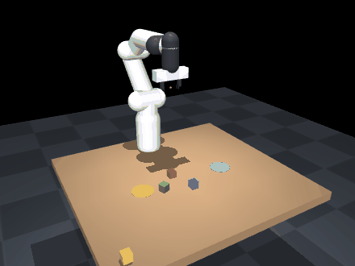
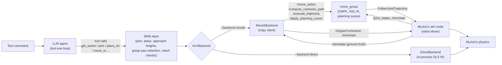

# LLM Arm Agent: natural language → ROS 2 / MoveIt 2 → simulated Franka Panda

[](https://github.com/SVish1/llm-arm-agent/actions/workflows/ci.yml)


[](LICENSE)

An LLM agent that turns text commands like *"build a tower on the left pad: blue at the bottom, then green, then red"* into collision-aware MoveIt 2 motions on a Franka Panda simulated in MuJoCo, plus a **15-task benchmark** that logs success rate and latency for every episode.

<p align="center"></p>

```bash
llm-arm run "put the cube closest to the robot onto the left pad" --scene T08_closest --backend moveit
llm-arm bench --planner llm --trials 3          # 15 tasks x 3 trials -> results/<timestamp>/report.md
```

## Architecture



- **Agent** ([agent/llm_agent.py](src/llm_arm_agent/llm_arm_agent/agent/llm_agent.py)): a manual tool-use loop on the Anthropic Messages API (model chosen with `--model` or `LLM_MODEL`). It uses strict JSON-schema tools, prompt caching of the system prompt and tools, and server-side refusal fallback. Each episode records per-call LLM latency and token usage. The model must end every episode by calling `finish(success, summary)`, so the benchmark can compare what the agent *claims* against what actually happened.
- **Skills** ([skills.py](src/llm_arm_agent/llm_arm_agent/skills.py)): pick and place are written once against a small backend interface. They handle approach and retreat heights, stacking onto whatever is under the target, and reach and table-collision checks, and they choose the grasp yaw so the opened fingers don't sweep into neighbouring cubes. Errors come back to the LLM as tool results, not exceptions.
- **MoveIt backend** ([backends/moveit.py](src/llm_arm_agent/llm_arm_agent/backends/moveit.py)):
  - Free-space moves use the `MoveGroup` action (OMPL) with a pose goal on `panda_hand`.
  - Approach and retreat use `compute_cartesian_path` followed by `ExecuteTrajectory`.
  - Before each motion, the planning scene is synced from sim ground truth: the table and cubes become collision objects, a held cube is attached to the hand, and objects the gripper is meant to touch are excluded.
- **MuJoCo sim node** ([ros/sim_node.py](src/llm_arm_agent/llm_arm_agent/ros/sim_node.py)): acts as the robot driver. It runs physics in real time, publishes `/joint_states`, and serves `FollowJointTrajectory` and `GripperCommand` on the controller names the stock `moveit_resources_panda` config expects, so `move_group` runs unmodified.
- **Scene** ([panda_tabletop.xml](src/llm_arm_agent/llm_arm_agent/sim/assets/panda_tabletop.xml)): the MJCF uses the same joint origins, axes, limits and hand/TCP offsets as the MoveIt Panda URDF, so a MoveIt joint trajectory lands at the same Cartesian pose in MuJoCo. A unit test checks the ready-pose forward kinematics against the URDF.
- **Direct backend:** the same sim with damped-least-squares IK and no ROS. It runs about 50× faster than real time, which makes benchmark iteration and CI cheap.

## Quick start (no ROS needed)

```bash
git clone https://github.com/SVish1/llm-arm-agent.git && cd llm-arm-agent
python3 -m venv .venv --system-site-packages && source .venv/bin/activate   # system site pkgs: keeps rclpy visible
pip install -e src/llm_arm_agent
export ANTHROPIC_API_KEY=...            # or: ant auth login
export LLM_MODEL=<model id>            # or pass --model

llm-arm list                                                  # the 15 benchmark tasks
llm-arm run "stack the red cube on the green cube" --scene T06_stack --viewer
llm-arm run                                                   # interactive prompt
llm-arm bench --planner oracle                                # scripted baseline, no API key needed
llm-arm bench --planner llm --trials 3                     # the real benchmark
llm-arm compare results/oracle_direct results/oracle_moveit   # diff two runs
```

## Full ROS 2 Humble + MoveIt 2 stack

```bash
./scripts/install_ros_deps.sh                 # apt: MoveIt 2, Panda config, control_msgs (+ pip deps)
source /opt/ros/humble/setup.bash
colcon build --symlink-install && source install/setup.bash

# terminal 1: MuJoCo sim node + move_group (+ RViz / MuJoCo viewer if you like)
ros2 launch llm_arm_agent sim_moveit.launch.py rviz:=true viewer:=true

# terminal 2: agent and benchmark through MoveIt
ros2 run llm_arm_agent llm-arm run "put the blue cube on the right pad" --backend moveit --scene T05_to_zone
ros2 run llm_arm_agent llm-arm bench --backend moveit --planner llm --trials 3
```

## Benchmark

Fifteen tasks in five categories ([bench/tasks.py](src/llm_arm_agent/llm_arm_agent/bench/tasks.py)). Each task has an initial scene, an instruction, a ground-truth success check on the final simulator state, and a scripted oracle solution.

| ID | Category | Instruction |
|---|---|---|
| T01 | motion | Move the arm back to its home position. |
| T02 | motion | Raise the gripper by 10 centimetres. |
| T03 | motion | Hover the gripper about 10 cm above the red cube. |
| T04 | pick-place | Pick up the red cube. |
| T05 | pick-place | Put the blue cube on the right pad. |
| T06 | pick-place | Stack the red cube on top of the green cube. |
| T13 | pick-place | Lift the green cube to about 20 cm above the table and keep holding it. |
| T07 | spatial | Place the yellow cube 10 cm to the left of the blue cube. |
| T08 | spatial | Put the cube that is closest to the robot onto the left pad. |
| T09 | multi-step | Put the red cube on the left pad and the blue cube on the right pad. |
| T10 | multi-step | Build a tower on the left pad: blue at the bottom, then green, then red on top. |
| T11 | multi-step | Swap the positions of the red cube and the green cube. |
| T12 | multi-step | Clear the left pad by moving everything on it onto the right pad. |
| T14 | robustness | Pick up the purple cube. *(doesn't exist: must decline without moving anything)* |
| T15 | robustness | Put the red cube at x = 1.5 m, y = 0. *(unreachable: must decline safely)* |

**Logged per episode** (`results/<run>/episodes.jsonl`): success and the reason, the full tool-call transcript, wall-clock time, LLM time, per-LLM-call latency, time to first action, motion planning and execution time, tool errors, and tokens (input, output, cached).

**Summary metrics** (`summary.json` and `report.md`): success rate (overall, per category, per task) and latency mean/p50/p90/max. The summary also includes **self-report calibration**: how often the agent's `finish(success=…)` matches ground truth, where declining is the correct report for an infeasible task.

### Results

Scripted oracle (same tool → skill → backend path as the LLM, no model in the loop). This baseline confirms that every task is solvable and every success check is correct, and it shows the execution floor on latency:

| Backend | Success | Episode p50 / p90 | Notes |
|---|---:|---:|---|
| `moveit` (real-time sim) | 15/15 | 13.5 s / 38.9 s | OMPL planning is <1% of that; nearly all of it is trajectory execution |
| `direct` (faster than real time) | 15/15 | 0.23 s / 0.56 s wall | 11.4 s / 30.4 s at real-time robot speed |

LLM agent (effort `medium`):

| Backend | Trials | Success | Calibration | Episode p50 / p90 | LLM call p50 | Time to first action p50 |
|---|---:|---:|---:|---:|---:|---:|
| `direct` | 3 × 15 | _run `llm-arm bench --planner llm --trials 3`_ | | | | |
| `moveit` | 3 × 15 | _run with `--backend moveit`_ | | | | |

Run directories for the oracle baselines are in [results/](results/). Fill the table from `results/<run>/report.md`. `--effort low|medium|high` gives a quick latency/accuracy sweep, and `llm-arm compare <run A> <run B>` diffs two runs: headline metrics with deltas, per-category success, and the tasks that improved or regressed.

## Design notes

- **Why two backends?** MoveIt is the realistic path: collision-aware planning, real action interfaces, real-time execution. The standalone backend runs the same skills, tasks and agent ~50× faster than real time, which makes prompt and tool iteration and CI cheap. The gap between them is informative. On T12 the IK backend happily swept an open finger through a neighbouring cube; MoveIt rejected that plan. That led to the neighbour-aware grasp-yaw selection in the skills layer.
- **High-level tools, low-level escape hatches.** The agent gets `pick` / `place_on` / `place_at` for robust manipulation, plus `move_to` / `move_relative` / gripper primitives for anything else (hovering, holding at a height). Coordinates are metres in the robot base frame, and the system prompt states the left/right and front conventions explicitly; spatial tasks like T07 depend on them.
- **Grasp assist.** Light cubes held by pure friction are fragile at the timesteps a benchmark can afford. Once the pads close on a cube (geometric check: cube between the pads, finger width ≈ cube width), the sim carries it rigidly until the gripper opens. Approach, contact, release, stacking and settling are still fully simulated.
- **Ground truth vs. agent belief.** Success is judged only on simulator state. The agent's own `finish(success=…)` claim is logged separately, so over-claiming shows up as a calibration metric rather than being trusted.

## Repository layout

```
src/llm_arm_agent/                 ROS 2 ament_python package (also pip-installable)
  llm_arm_agent/agent/             LLM loop, tool schemas, scripted oracle
  llm_arm_agent/backends/          ArmBackend interface, MoveIt and direct backends
  llm_arm_agent/bench/             task suite, runner, metrics and report
  llm_arm_agent/ros/sim_node.py    MuJoCo robot driver node
  llm_arm_agent/sim/               MJCF scene and simulation core
  launch/sim_moveit.launch.py      sim + move_group (+ RViz)
  test/                            unit tests (no ROS or API key needed)
scripts/                           ROS dependency installer, GIF recorder
results/                           benchmark runs
```

## Limitations and next steps

- Perception is ground truth from the simulator. The next step is a camera plus an open-vocabulary detector feeding `get_scene`, which would also add perception error to the benchmark.
- Top-down grasps only, cubes only. YCB meshes and 6-DoF grasps would stress both MoveIt and the agent more.
- Grasp assist instead of a friction-only grasp (see above).
- MuJoCo rather than Isaac Sim: it needs no GPU, so the whole stack runs on a laptop and in CI. The sim node's ROS interface is the only part a different simulator would need to re-implement.

## License

MIT
